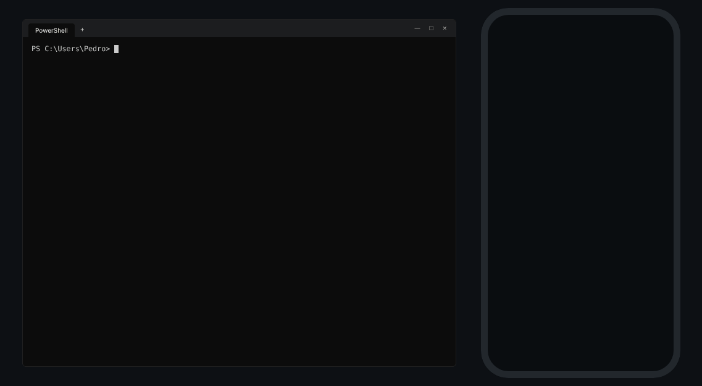
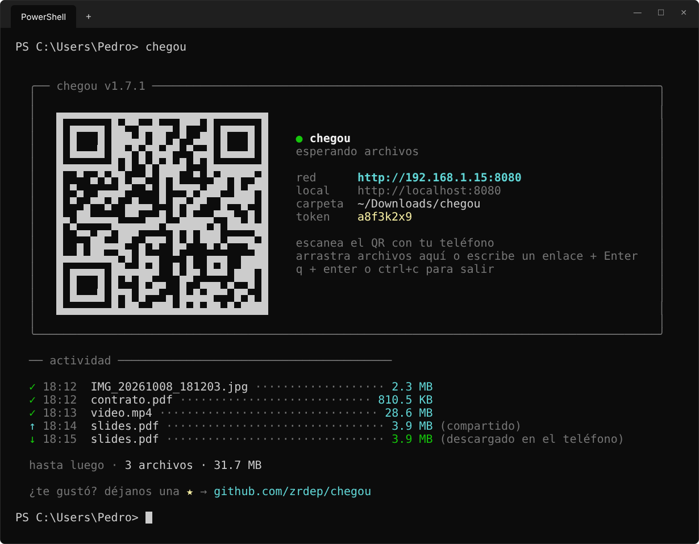
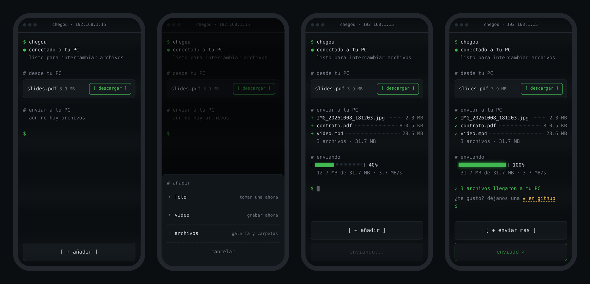

<div align="center">

[English](README.md) · **Español** · [Português](README.pt-BR.md)



<br><br>

**pasa archivos entre tu móvil y tu PC por la red local. un comando, un código QR, listo.**

<br>


</div>

<br>

```
› recibir      fotos, vídeos y archivos desde tu móvil, directos a una carpeta del PC
› enviar       archivos, texto y enlaces desde tu PC a tu móvil
› cámara       haz una foto o graba un vídeo y aparece en tu PC
› arrastrar    suelta un archivo o carpeta en el terminal y aparece en el móvil
› seguro       un token dentro del QR: solo entra quien lo ha escaneado
› desechable   nada que instalar en el móvil, nada en ejecución tras ctrl+c
```

> *chegou* (she-GOU) significa en portugués *«ha llegado»*.

---

## ▸ cómo funciona

<div align="center">



</div>

1. ejecuta `npx chegou` en tu PC
2. escanea el código QR con tu móvil
3. envía lo que quieras, en los dos sentidos

sin app, sin cuenta, sin internet. solo hace falta que los dos dispositivos estén en la misma red.

---

## ▸ instalación

sin instalar nada:

```bash
npx chegou
```

o de forma permanente:

```bash
npm install -g chegou
```

requiere **Node.js 20.19+** o **22.12+** (con versiones anteriores muestra un aviso y se cierra).

---

## ▸ uso

```bash
chegou                        # se abre y espera archivos desde tu móvil
chegou photo.png video.mp4    # deja estos archivos listos para descargar en el móvil
chegou ./photos               # todos los archivos de una carpeta
chegou https://youtube.com    # envía un enlace o un texto al móvil
chegou --timeout 10           # se cierra tras 10 min sin uso
chegou --relay                # usa el túnel: funciona desde cualquier red
chegou --local                # usa la red local sin preguntar
chegou --lang es              # terminal en español
```

al arrancar, chegou te pregunta cómo se conectará tu móvil (flechas + Intro, o `1`/`2`):

```
  ¿cómo se conectará tu móvil?

  › 1  local   misma wi-fi · más rápido · sin límite de tamaño
    2  túnel   cualquier red · vía Cloudflare · hasta 100 MB por archivo
```

usa `--local` o `--relay` para saltarte la pregunta.

mientras chegou está en marcha, **suelta archivos o carpetas en la ventana del terminal** o escribe un texto o un enlace y pulsa Intro: el móvil lo recibe al instante.

### opciones

| opción | abreviada | qué hace | por defecto |
|---|---|---|---|
| `--relay` | `-r` | usa el túnel de Cloudflare, funciona desde cualquier red (o `--tunnel`) | pregunta |
| `--local` | `-l` | usa la red local, sin preguntar | pregunta |
| `--port <número>` | `-p` | puerto preferido (si está ocupado, se usa el siguiente libre) | `8080` |
| `--dir <ruta>` | `-d` | dónde guardar lo que llega del móvil | `~/Downloads/chegou` |
| `--timeout <min>` | `-t` | se cierra tras X minutos sin uso (`0.5` = 30 s) | desactivado |
| `--open [on\|off]` | | abre la carpeta (con el archivo seleccionado) cuando llega el 1.er archivo. sin valor, alterna entre activado y desactivado, y la elección se guarda | on |
| `--lang <idioma>` | | idioma del terminal (`en`, `es`, `pt`) | el del sistema |
| `--help` | `-h` | muestra la ayuda | |

### variables de entorno

| variable | qué hace |
|---|---|
| `CHEGOU_LANG` | idioma del terminal, igual que `--lang` |
| `CHEGOU_NO_UPDATE_CHECK=1` | no consulta npm en busca de una versión nueva (`NO_UPDATE_NOTIFIER` también vale) |
| `CHEGOU_CONFIG_DIR` | dónde se guarda `settings.json`. por defecto: `%APPDATA%\chegou` en Windows, `~/.config/chegou` en los demás |

---

## ▸ ¿red local o túnel?

| | red local | túnel |
|---|---|---|
| cuándo | PC y móvil en la misma wi-fi | redes distintas, datos móviles, wi-fi de campus o cafeterías |
| velocidad | la de tu red (rápida) | depende de las dos conexiones a internet |
| límite | ninguno | 100 MB por archivo (límite de Cloudflare) |
| ruta | solo tu red | servidores de Cloudflare, por HTTPS |

el túnel usa [Cloudflare Quick Tunnels](https://try.cloudflare.com) (gratis, sin cuenta). la primera vez, chegou descarga `cloudflared` (~30 MB); después se abre al instante. la dirección es aleatoria y el token es más largo, ya que la URL es pública.

---

## ▸ pantallas

**en el PC**



**en el móvil**: inicio, menú de añadir, envío y hecho



---

## ▸ seguridad

- cada sesión crea un **token aleatorio** que va dentro del código QR; conocer solo la IP te da un `401`
- el token se comprueba **antes** de aceptar un solo byte del archivo
- los nombres de archivo se sanean (sin `../../`) y nunca se sobrescribe nada: `photo.jpg` pasa a ser `photo (1).jpg`
- con `--timeout`, el servidor se apaga solo si te olvidas de cerrarlo
- en la red local, el tráfico es **HTTP** sin cifrar: úsalo en redes de confianza
- en el túnel, el tráfico es **HTTPS**, pero pasa por los servidores de Cloudflare

---

## ▸ preguntas frecuentes

<details>
<summary><b>¿por qué no usar simplemente LocalSend?</b></summary>
<br>

LocalSend es genial y más completo (cifrado, funciona entre cualquier dispositivo). chegou es distinto en cómo se usa:

- **nada que instalar en el móvil**: escaneas el QR y se abre en el navegador. práctico cuando no es tu móvil
- **es un comando**: `npx chegou`, envías lo que necesitas, `ctrl+c`. nada se queda ejecutándose en segundo plano
- **vive en el terminal**: suelta archivos en la ventana y úsalo dentro de tu flujo de trabajo de desarrollo

si pasas archivos entre tus propios dispositivos todos los días, LocalSend probablemente sea mejor opción. chegou es para el «necesito este archivo ahí ya, y ya estoy en el terminal».

</details>

<details>
<summary><b>¿es seguro ejecutar <code>npx</code>?</b></summary>
<br>

ser prudente es sano: ejecutar paquetes de npm al azar es un riesgo real. por eso chegou es pequeño y abierto: un puñado de archivos en `bin/`, `src/` y `public/`, que se leen en pocos minutos. las únicas dependencias son `fastify` (y plugins oficiales), `picocolors`, `qrcode-terminal` y `untun` (para el túnel).

lo que hace en tu PC: abre un puerto en la red local mientras se ejecuta y escribe archivos solo en la carpeta que elijas. no instala nada y no se ejecuta en segundo plano. en modo red local los archivos nunca salen de tu red. accede a internet en dos casos: para buscar una versión nueva en npm (se desactiva con `CHEGOU_NO_UPDATE_CHECK=1`) y cuando eliges el túnel.

si prefieres ejecutarlo desde el código fuente:

```bash
git clone https://github.com/zrdep/chegou
cd chegou && npm install && node bin/chegou.js
```

</details>

<details>
<summary><b>el móvil no consigue abrir la página</b></summary>
<br>

- asegúrate de que el PC y el móvil están **en la misma wi-fi** (desactivar los datos móviles ayuda)
- en Windows, el **firewall** pregunta la primera vez: marca *redes privadas* y permítelo
- comprueba que la IP del terminal coincide con la de tu adaptador wi-fi en `ipconfig`

</details>

<details>
<summary><b>funciona en casa pero no en el campus o en una cafetería</b></summary>
<br>

las redes públicas suelen aislar los dispositivos entre sí (aislamiento de AP). para eso usa el **túnel**:

```bash
chegou --relay
```

o elige **túnel** cuando chegou te pregunte. crea una dirección pública a través de Cloudflare, así que funciona aunque el PC esté en la wi-fi del campus y el móvil con datos móviles. el límite es de 100 MB por archivo.

</details>

---

## ▸ idiomas

chegou habla **inglés**, **español** y **portugués**. el terminal sigue el idioma de tu sistema y la página del móvil sigue el del móvil, cada uno por su cuenta. para forzar uno: `--lang es` en el terminal o `?lang=es` en la URL del móvil.

la traducción al inglés y al portugués la hizo [Pedro Randolfo](https://github.com/zrdep).

la traducción al español la hizo [Óscar Álvarez Lucas](https://github.com/oalvluc0702). ¡gracias!

¿quieres añadir un idioma? son dos archivos:

```
src/i18n/en.js       → textos del terminal
public/i18n/en.js    → textos de la página del móvil
```

copia ambos usando el código del idioma (p. ej. `fr.js`), tradúcelos, regístralos en `src/i18n/index.js` y en `public/index.html`, y abre un PR.

---

## ▸ código

```
bin/chegou.js          punto de entrada del comando
src/
  main.js              el flujo: opciones → red → servidor → túnel → banner
  config.js            números fijos (puerto, límites, tamaño del token)
  cli/                 todo lo del terminal: opciones, pregunta, banner, --timeout
  server/              servidor: subida, descarga, compartición, token
  net/                 red: IP, puerto libre, túnel de Cloudflare
  i18n/                textos del terminal (en, es, pt)
public/
  index.html, app.js   la página del móvil
  i18n/                textos de la página (en, es, pt)
```

---

## ▸ stack

```
node.js · fastify · html/css/js puro
```

---

<div align="center">

hecho por [Pedro Randolfo](https://github.com/zrdep) · MIT

si te ha servido, deja una ⭐

</div>
